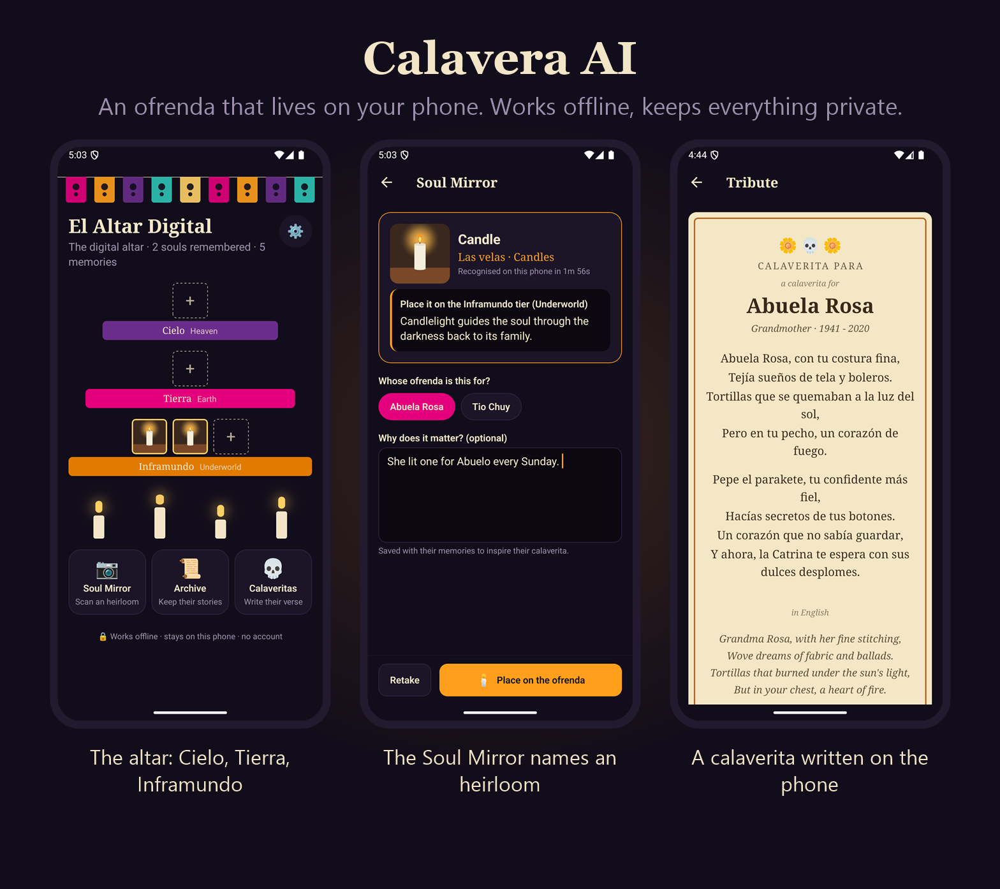
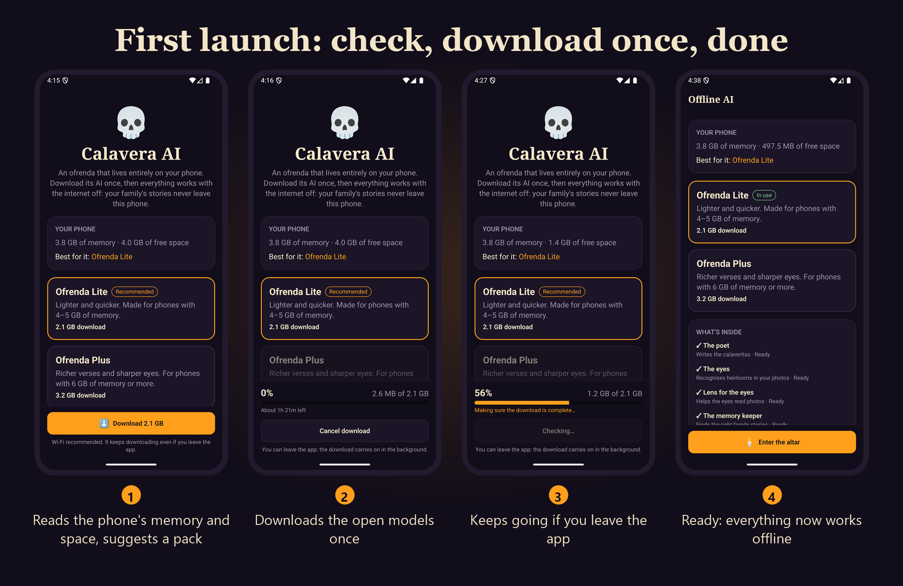
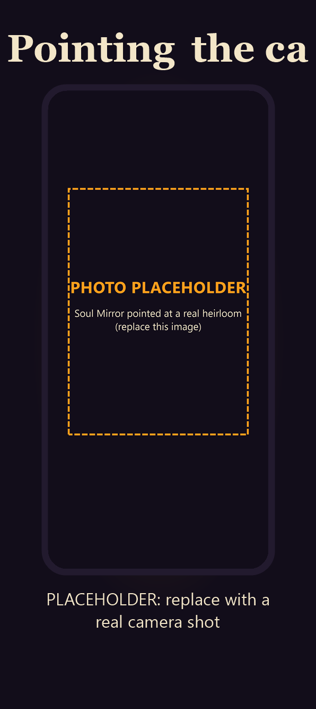
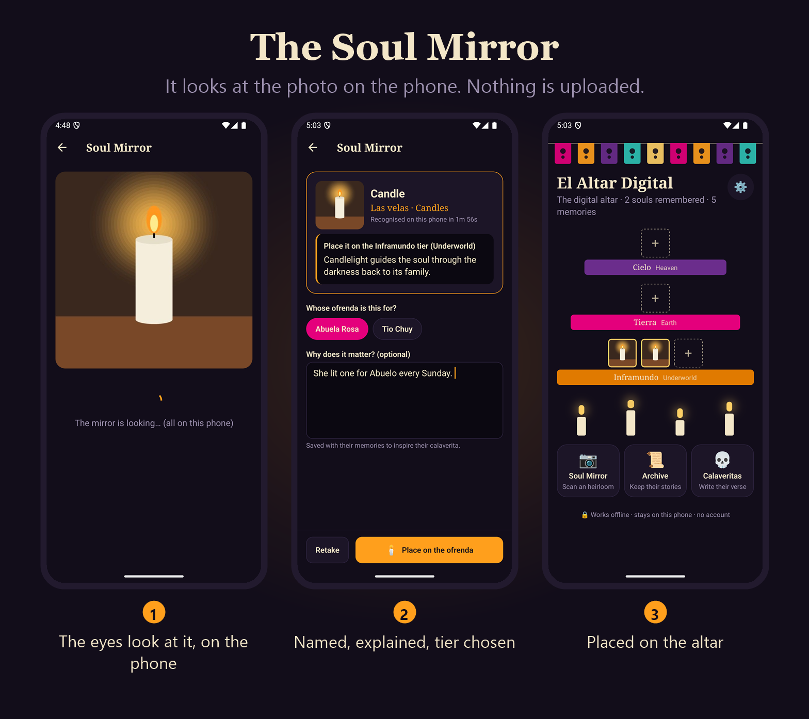
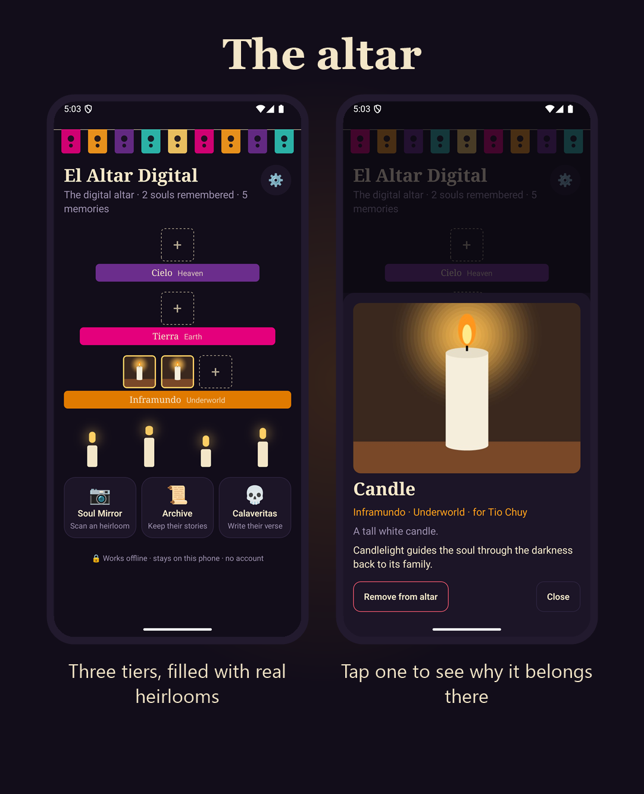
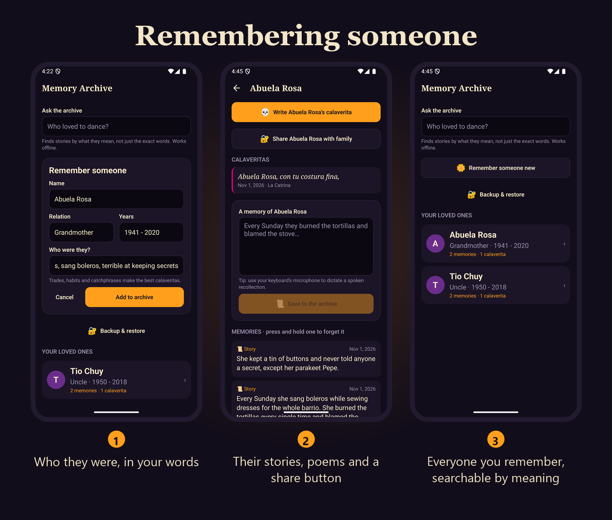
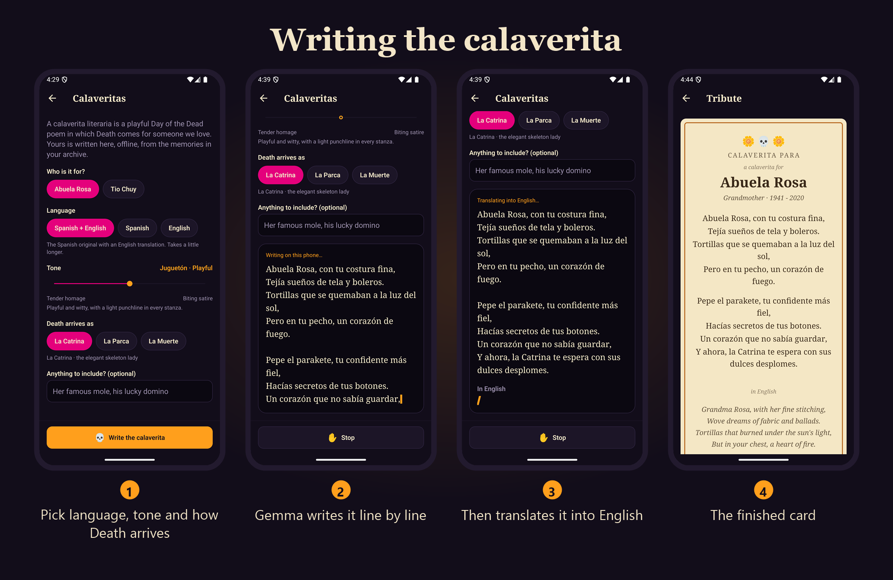
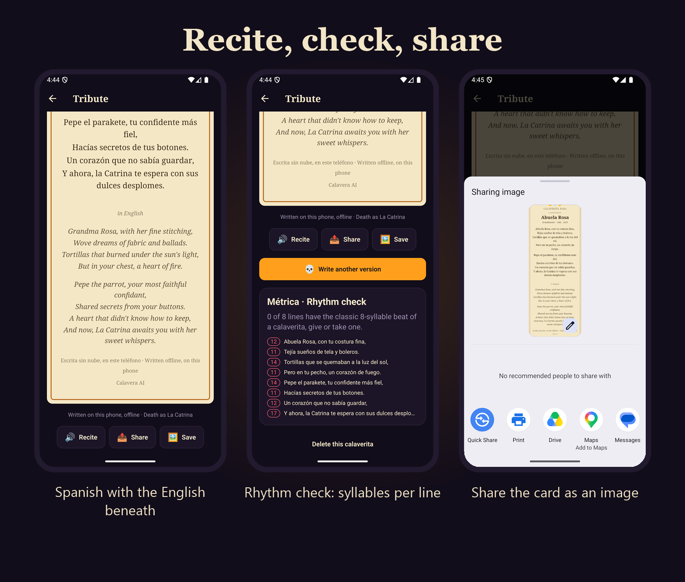
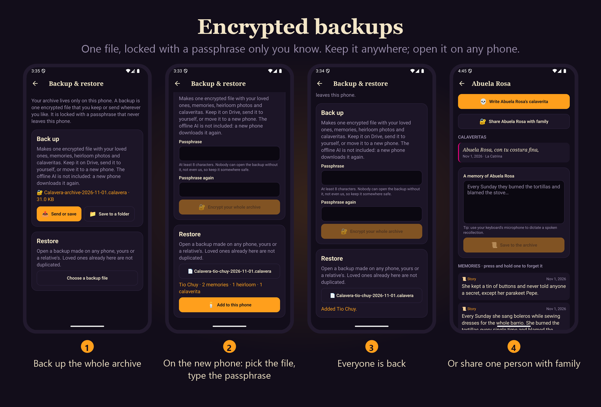

*This is a submission for the [Hacktoberfest Open-Source AI Challenge Week 4: Ghost in the Machine](https://dev.to/challenges/hacktoberfest-week4-2026-10-26).*

## What I Built



**Calavera AI** is an Android app for Día de los Muertos that keeps a family's memories of the people they've lost, and uses them to write a *calaverita literaria* for each of them. Everything runs on the phone: three open-weight models do the work, and nothing you put into the app ever leaves it.

A calaverita literaria is a Mexican tradition: a short, rhyming, affectionate (and usually cheeky) poem in which Death comes to take someone, written as if they were still here. They're read aloud, printed in newspapers and left on altars every November. They're funny on purpose. They work because they're specific: a grandmother who burned the tortillas every Sunday and blamed the stove gets a very different poem than an uncle who fixed every radio in the barrio.

That's what the app is for. You build a small archive of a person (who they were, the stories the family tells about them, photos of the things they left behind) and the app turns it into three things:

- **A digital ofrenda.** Photograph an heirloom (a rosary, a candle, their favourite cup) and the app recognises it, explains its traditional meaning, and places it on the right tier of a three-tier altar: Cielo (heaven), Tierra (earth) or Inframundo (the underworld).
- **A memory archive** you can search by meaning: "who loved to dance?" finds the right story even if it never uses the word "dance".
- **Calaveritas** written from those memories, in Spanish, English, or Spanish with an English translation, on a parchment card you can recite, share or save.

### How I interpreted "Ghost in the Machine"

I took the theme literally in the gentlest way I could think of: the people we miss live on in the stories we keep telling about them, and here those stories live inside a machine that never sends them anywhere. The "ghost" is the voice the poem gives back to someone, and the "machine" is a phone that can do it with the internet switched off, in a cemetery, on the night of November 1.

### Why privacy is the whole point

Memories aren't data in the usual sense. They're how we feel about someone: the joke only your family understands, the illness nobody talks about, the photo of a hand-written recipe. You wouldn't want a company training its next model on your grandmother, and you shouldn't have to trust a privacy policy to make sure it doesn't. So the app is built so that it *can't* send anything:

- no account and no sign-in;
- no server, no analytics, no crash reporter;
- the only network access is downloading the open models once, from Hugging Face, and every file is checked against its published SHA-256;
- after that, the whole app works in airplane mode.

## Demo

> **TODO before publishing:** upload `calavera.mp4` to YouTube (or Loom) and replace this note with an embed of its link.

The video is built from screenshots of the real app running on an Android emulator. Its voiceover is AI-generated with **ElevenLabs** text-to-speech: that's the only part of this project that used a cloud service. The app itself never does.

**Try it:** install the Android APK from the [v1.0.1 release](https://github.com/codewithveek/calavera-ai/releases/tag/v1.0.1) (arm64, 103 MB). On first launch it recommends a model pack for your phone and downloads it (about 2.1 GB for the Lite pack, so use Wi-Fi). There is no login. A good test path:

1. **Archive → Remember someone**: add a person and a couple of stories.
2. **Soul Mirror**: photograph or pick a picture of an object (a candle works well) and place it on the altar.
3. **Calaveritas**: pick "Spanish + English" and write one. Then recite it, save the card, and look at the rhythm check.
4. **Archive → Backup & restore**: make an encrypted backup and restore it.

## Code



MIT licensed. Expo SDK 58, React Native 0.88 (New Architecture, Hermes), TypeScript, about 130 source files. The README has the full architecture and build instructions.

## How I Built It

### The open pieces

| Job | Open model / project | Size on the phone |
| --- | --- | --- |
| Writing the poems | **Gemma 2 2B Instruct** (Q4_K_M), or **Gemma 4 E2B** (Q4_0) on bigger phones | 1.7 GB / 2.8 GB |
| Seeing heirlooms | **SmolVLM 500M Instruct** (Q8_0) + its vision projector, or Gemma 4 E2B's own vision projector | 437 MB + 109 MB / 557 MB |
| Finding memories | **all-MiniLM-L6-v2** (Q8_0) sentence embeddings | 25 MB |
| Running them | **llama.cpp** through **llama.rn** (JSI bindings, no bridge) | |
| Storing them | **SQLite** + **sqlite-vec** (vector search inside SQLite) | |

All the weights are GGUF files from Hugging Face. Everything else is Expo and React Native.

### The architecture

```
 📷 Soul Mirror ─────────── photo → 512 px → vision model → name + one sentence
      │                                      → cultural knowledge base → Cielo / Tierra / Inframundo
      ▼
 📜 Memory archive ──────── story → sentence chunks → MiniLM (384-d) → sqlite-vec (partitioned per person)
      │
      ▼
 💀 Calaveritas ─────────── top memories + ofrenda items → Gemma → streamed poem (+ English pass)
      │
      ▼
 🕯️ Tribute ──────────────── parchment card · offline text-to-speech · PNG export · rhythm check
```

The code follows that shape: one folder per feature (`models`, `engine`, `mirror`, `ofrenda`, `memories`, `profiles`, `verse`, `tributes`, `backup`), route files that are thin wrappers, **TanStack Query** for everything read from SQLite or disk (with `networkMode: 'always'`, so it behaves the same in airplane mode) and **zustand** for live state like download progress and the streaming poem.

### 1. The device check and choosing a model

Phones that can run a 2B model offline range from comfortable to barely. So the first screen measures the phone before it downloads anything:

- **Memory:** the app reads the phone's total RAM. Under 5.4 GiB it recommends **Ofrenda Lite** (Gemma 2 2B writes, SmolVLM 500M sees, 2.1 GB in total). From 5.4 GiB it recommends **Ofrenda Plus** (one multimodal Gemma 4 E2B both writes and sees, 3.2 GB).
- **Storage:** before downloading, it checks free space for the missing bytes plus 300 MB of headroom, and tells you exactly how much to free up if there isn't enough.
- **You choose:** the recommendation is a default, not a lock. You can switch packs later and remove the one you don't use.

The names on screen are deliberately not "Gemma 2 2B Q4_K_M". People see "the poet", "the eyes", "lens for the eyes" and "the memory keeper", each with what it does ("Writes the calaveritas"). Loading reads *"Waking the poet…"*. It's an app for families, not for people who know what quantisation is.



### 2. Downloads that survive leaving the app

Two gigabytes over a phone connection takes a while, and nobody will sit on a setup screen for 40 minutes. My first version downloaded inside the app. As soon as you minimised it, Android froze the process and the download stopped.

So I wrote a small **local Expo module in Kotlin** that hands every file to Android's own **DownloadManager**, the same service the Play Store and Chrome use. That gave me a lot for free:

- **It keeps going** with the app minimised, or even closed. I tested it by reinstalling the app halfway through a download: Android kept downloading, and when the app came back it reattached to the downloads (their IDs are saved), checked the finished files and switched to the pack.
- **It runs in parallel.** All four files download at once, which cut the time on my test setup from 40+ minutes to about 10–15.
- **It shows the system notification**, waits for Wi-Fi or a connection by itself, and needs no extra permissions.

Two surprises worth knowing if you try this:

1. DownloadManager **allocates the whole file up front**, so a `.part` file's size says nothing about progress. Progress comes from DownloadManager's own byte counts instead.
2. It can only write to the app's folder on shared storage, which is private to the app on Android 11+ and removed on uninstall. Expo's file API can't *create* files there, so the module also does the atomic rename from `.part` to the final name.

Nothing is used until it passes a **size check and a SHA-256 check** against Hugging Face's published hash.

### 3. The Soul Mirror: a vision model that names your heirloom





The photo is downscaled to 512 px (fewer image tokens, faster, and a small thumbnail to keep), then the vision model is asked what it sees. The model only names the object. A small **cultural knowledge base** of 17 ofrenda elements decides where it goes and why, because I didn't want a 500M-parameter model inventing traditions:

- a portrait or rosary goes to **Cielo**;
- pan de muerto, a sugar skull or their favourite drink go to **Tierra**;
- candles, marigolds (*cempasúchil*), copal, water and salt go to **Inframundo**;
- anything personal (a hat, a guitar, a tool) is a *recuerdo personal* on Tierra.

The Spanish names always come with English beside them ("Las velas · Candles") and a sentence about what the element means. The scan is then saved as a memory, so the poem can mention it.



**The most interesting bug of the project lived here.** I first forced the vision model to answer in JSON with a llama.cpp grammar built from a JSON schema. It worked, but a single scan took **over 10 minutes** on my test emulator. Per-thread profiling showed the four inference threads mostly *waiting*: sampling the next token against the grammar took about **4.7 seconds per token** on a weak CPU. The fix was to stop fighting the model. Small vision models naturally answer *"Candle. It has an orange flame."*, so the prompt now asks for exactly that, and a forgiving, unit-tested parser reads it (it also accepts labelled lines and JSON, even cut off). The same scan dropped to **about 27 seconds**. A repetition penalty stopped the model looping ("con un poder de vivir, con un poder de vivir…").

### 4. The memory archive: semantic search inside SQLite



Each story is split into sentence-aligned chunks (up to 480 characters, overlapping by one sentence), each chunk becomes a 384-dimensional vector with MiniLM, and the vectors go into a **sqlite-vec** `vec0` table **partitioned by person**, with cosine distance. Searching one person's memories only scans their partition. "Ask the archive" uses the same index across everyone.

Everything lives in one SQLite file. That made one bug easy to hit: expo-sqlite's `withExclusiveTransactionAsync` quietly opens a *second* connection, and SQLite extensions and the `foreign_keys` setting are both per-connection. So the vector table "didn't exist" inside transactions, and deleting a person would silently have skipped the cascade to their memories and poems. All writes now go through one helper on the main connection, one transaction at a time.

A second bug only showed up while I was taking the screenshots for this post: whatever I searched for, the newest memory came first, and searching a story's exact words scored it 10%. llama.rn's `embedding()` empties the model's cache but keeps a list of the previous prompt's tokens, so the next text skipped the part it shared with the last one and was embedded from a fragment. Clearing that state before each embedding (`clearCache()`) put the exact match back on top, and a one-time migration re-indexes memories saved before the fix.

### 5. Writing the calaverita



The poem is retrieval-augmented generation on a phone:

1. **Retrieve:** the four memories closest to the person's profile and anything you asked to include, capped at about 1,100 characters so the CPU doesn't spend forever reading the prompt, plus the names of their ofrenda items.
2. **Prompt:** a fixed block of rules (two or three quatrains, aim for 8 syllables a line, witty but never cruel, Death comes for them) followed by the person. The rules come *first* and never change, so llama.cpp can reuse their KV cache between poems.
3. **Choose:** a tone slider from *tender homage* to *biting satire*, how Death arrives (La Catrina, La Parca or La Muerte) and the language.
4. **Plan, then write:** the model first plans rhyming pairs inside a hidden `<rimas>` tag, then writes the poem. Small models sometimes forget to close that tag, which made perfectly good poems vanish. The parser now treats everything after the one-line plan as the poem.
5. **Stream:** tokens are batched into about 12 screen updates a second, and only the poem component re-renders.

**Spanish, English or both.** Calaveritas are a Spanish-language tradition, but most people reading this post (and many families) want to understand the poem. The default writes the Spanish original and then runs a second pass that translates it line by line into English, streamed underneath. A failed translation never costs you the poem.

**The tribute.** The poem goes on a parchment card with the person's name and years, which you can save as a PNG or share. The phone's offline text-to-speech recites it in a Mexican Spanish voice, then the English translation in an English one. A **rhythm check** counts syllables per line the way Spanish poetry does (joining vowels across words, the *sinalefa*, and adjusting for where the last word is stressed) and shows which lines have the traditional eight-syllable beat. English poems get a simpler estimate. It's honest: a 2B model writes long lines, and the check says so.



### 6. Encrypted backups: lose the phone, not the memories

Keeping everything on the phone has an obvious cost: if you lose the phone, you lose your grandmother's stories. You might also want them on a new phone, or want to give your cousin everything you've collected about her.

That's what the encrypted backup is for. **Archive → Backup & restore** packs everything into one file:

- **What's inside:** your loved ones, their memories, the heirloom photos and every calaverita. The AI models aren't included (a new phone downloads them again), so a typical backup is a few megabytes, small enough for a chat or an email.
- **How it's locked:** **AES-256-GCM**, with the key derived from your passphrase using **PBKDF2-SHA256** at 600,000 iterations. The passphrase never leaves the phone and is never stored. Without it, nobody can open the file, including me. The key derivation runs in native Kotlin (a second tiny local module), because a pure-JavaScript PBKDF2 at that strength would take far too long on a cheap phone. The file's header is authenticated too, so it can't be quietly altered.
- **Where it goes:** you choose. Android's share sheet sends it to Drive, a chat with yourself, email or Bluetooth, or you save it to a folder.
- **Restoring:** open the file on any phone, enter the passphrase, see what's inside ("Abuela Rosa · 3 memories · 2 heirlooms · 2 calaveritas") and add it. People already on that phone aren't duplicated, and memories are re-indexed on the new phone, so the file doesn't depend on which model pack you use.
- **Sharing one person with family:** from a person's page, "Share Abuela Rosa with family" makes a backup of just her. Your sibling adds her to their own Calavera AI and can add their own memories. Día de los Muertos is a family tradition; the archive can be too.

Because it's standard cryptography and not something home-made, I could check it from outside the app: a backup written by Node.js's built-in `crypto` restores in the app (and a wrong passphrase is refused), and a backup made by the app decrypts in Node, with the heirloom photo byte-for-byte identical to the original.



That's how I squared "nothing leaves the device" with "don't lose it": the only copy that ever leaves is one you made, encrypted with a passphrase only you know, sent where you chose.

### 7. Making it work on a cheap phone

The target was phones with 4–6 GB of RAM, so performance shaped almost every decision:

- **One big model in memory at a time.** A first-in, first-out queue serialises all inference, and phones under 7.5 GB keep a single generative model loaded. The vision add-on is dropped before writing, and big models are released 30 seconds after the app goes to the background.
- **Memory-mapped weights** (`mmap`, no `mlock`), a 2K context, one sequence, four threads.
- **CPU only, by design.** llama.rn ships a Snapdragon Hexagon/OpenCL build to every phone. A config plugin leaves it out, which shrank the APK from 119 MB to 103 MB.
- **Lean rendering:** React Compiler, FlashList for long lists, `activityEnabled` screens, candles that flicker on the UI thread with Reanimated (and stop when "reduce motion" is on), and a progress bar that animates with a transform instead of re-laying out.
- **Honest numbers.** I tested on an x86 Android emulator with 4 GB of RAM, which is harder than a real phone: its virtual CPU has no AVX2, so llama.cpp falls back to slow paths. Even there, Gemma 2 2B writes at about 1.8 tokens a second, and a heirloom scan takes about 27 seconds once the vision model is loaded (the first scan, which loads it, takes closer to two minutes). Modern arm64 phones, which llama.cpp is heavily optimised for, are much faster.

## Why Does Open Innovation Matter?

Because this app can't exist any other way.

- **Privacy that doesn't depend on trust.** With a closed API, every story and photo would be uploaded to someone else's servers to be processed, logged, and maybe used for training. Here, open weights run on the phone, so there's nothing to upload. The privacy isn't a promise in a policy; it's how the app is built.
- **It works with the lights, and the internet, off.** People visit graves and build ofrendas in places with no signal. Open models running locally don't care.
- **It can't be switched off.** A family's archive of the dead is supposed to last decades. A closed API can raise its prices, change its terms or shut down. These GGUF files, llama.cpp and SQLite will keep working on that phone regardless.
- **I could look inside and change things.** The two biggest wins in this project came from being able to see and change how the model runs: dropping the grammar sampler made scans 20× faster, and keeping the same prompt prefix lets llama.cpp reuse its cache. With a black-box API I could only have waited.
- **It costs nothing to run.** No per-token bill, so writing ten versions of a poem is free.
- **Right-sized models.** I could pick a 25 MB embedding model, a 500M vision model and a 2B writer for cheap phones, and a bigger Gemma 4 for better ones, instead of one model sized for a data centre.

## My Agent Session

> **TODO (optional):** save the session with DevRelay and embed it here, or remove this section. Check the transcript for anything private before making it public.

## The Spirit of It

On November 1 and 2, families set out a photo, some marigolds, a candle, and the food the person loved, so that the dead can find their way home for a night. Calaveritas are part of that: laughing *with* the people we've lost, not just grieving them.

I wanted to build something that belongs on that altar. It doesn't replace anyone and it doesn't pretend to be them: it remembers what you tell it, keeps it to itself, and gives it back as a little poem that makes the family laugh. If you build an ofrenda this week, I hope it helps you write one for someone you miss. 🕯️🌼

## Prize Categories

- **Best Use of Gemma.** Gemma writes every calaverita (Gemma 2 2B Instruct on 4–5 GB phones, Gemma 4 E2B on 6 GB+ phones), translates it into English, and on the Plus pack Gemma 4 E2B is also the vision model that recognises heirlooms. All of it runs on-device through llama.cpp.

---

*Built with help from Claude Code (Anthropic) as a pair programmer: architecture, code, debugging on the emulator, and drafting this post. Every feature described here was tested on an Android emulator before writing about it.*

*Thanks for participating!*
